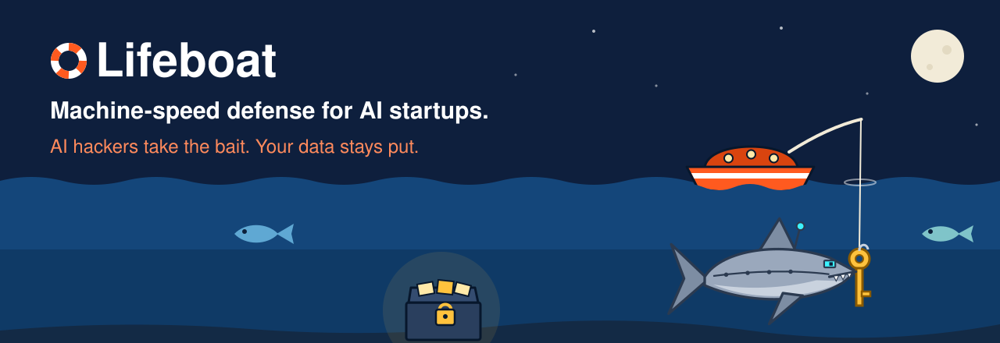
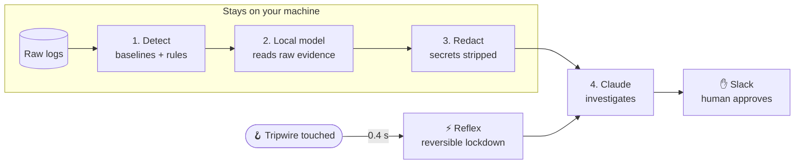

> **Live demo paused.** To run Lifeboat yourself, clone this repo, add your own Anthropic API key to `.env`, and follow the setup steps below.

<p align="center">
  
</p>

<p align="center">
  <a href="https://lifeboat-xlxn.onrender.com/"></a>
  
  
  
</p>

<h3 align="center">Machine-speed defense for AI startups that don't have a security team.</h3>

---

## The problem

Attackers are starting to use AI agents that move faster than any person can respond. CrowdStrike's [2026 Global Threat Report](https://www.crowdstrike.com/global-threat-report.html) puts the average time from break-in to spreading across systems at 29 minutes, and the fastest it observed at 27 seconds.

Small AI startups hold customer datasets, private models and cloud keys. Most of them have no one watching at 2 AM.

## The idea

**AI agents act on text they find.** So Lifeboat leaves bait that only an automated attacker would follow, and the moment it bites, Lifeboat locks things down.

- 🪝 **Bait:** a note in `AGENTS.md` asking agents to "register" at an internal URL, plus a canary AWS key planted next to the real ones.
- ⚡ **Reflex (no AI, under half a second):** isolate the pod, suspend the identity, quarantine the dataset, suspend the uploader. Every automatic action can be undone.
- 🔍 **Investigate:** Claude rebuilds the timeline, measures the blast radius and writes the incident report.
- ✋ **Approve:** anything permanent, like rotating real keys, waits for a human in Slack.

## Results

The same simulated attack, replayed twice:

| | 🔴 Protection off | 🟢 Protection on |
|---|:---:|:---:|
| Customer files read | ~250 | **0** |
| Private models downloaded | 12 | **0** |
| Secrets exposed | 6 | **0** |
| Time to contain | never | **0.4 s** after the tripwire |

> The cloud, the company and the attacker in the demo are simulated. No real cloud APIs are called.

## How it works

Customer data stays private: three of the four stages never leave your machine, and Claude only sees scrubbed findings.



| # | Stage | Where | What it does |
|---|---|---|---|
| 1 | **Detect** | local, deterministic | Learns each identity's normal behavior over the first 6 hours, then flags machine-speed bursts (the AI-attacker tell) and 16 ML-pipeline rules: remote-code dataset loaders, template injection, shells from workers, service-account token reads, 403 enumeration, env and kubeconfig dumps, new-IP credential use, S3 fan-out, private-model downloads. |
| 2 | **Read raw evidence** | local open-weight model | Reads payloads, decoded commands and env dumps with Ollama, llama.cpp or LM Studio. Falls back to a rule-based analyzer if no model is running. |
| 3 | **Redact** | local, enforced in code | Strips keys, tokens, JWTs and secrets, and swaps employee emails for pseudonyms. `assert_clean()` blocks any request that still contains a secret-shaped string. |
| 4 | **Investigate** | Claude (tool use) | Gets only redacted findings (about 98 KB instead of 4.6 MB of raw logs). Uses tools to judge each lead, rebuild the timeline, order key rotation, draft containment steps and a customer notification, then posts to Slack. |

The UI shows bytes kept on your machine vs. bytes sent to Claude, and **View** shows exactly what each request to Claude contained.

## Try it

**Online:** [lifeboat-xlxn.onrender.com](https://lifeboat-xlxn.onrender.com/). Run the attack with protection off, then on. (The public demo uses the rule-based analyzer in place of the local model.)

**Locally (about 5 minutes):**

```bash
pip install -r requirements.txt
python gen_logs.py                 # synthetic weekend of logs (12,460 events)
python gen_logs.py --background    # normal activity for the live replay

# optional, but it's the point: a local model
ollama pull qwen3:8b               # ~5 GB (on slow wifi: qwen3:4b, then LOCAL_MODEL=qwen3:4b)
ollama serve

export ANTHROPIC_API_KEY=...       # the Claude step
export SLACK_WEBHOOK_URL=...       # optional: posts alerts to Slack
python server.py                   # open http://localhost:8000
```

No local model? It uses the rule-based analyzer. No API key? It writes a rule-based report. The demo never hard-fails.

<details>
<summary><b>Settings</b></summary>

`CLAUDE_MODEL` (default `claude-sonnet-5-5`), `LOCAL_MODEL`, `LOCAL_LLM_URL`, `LOCAL_LLM_API=ollama|openai` (for llama.cpp, LM Studio, vLLM), `LOG_PATH` (your own JSONL), `PORT`.
</details>

<details>
<summary><b>The simulated incident</b></summary>

"Tessera AI" is a fictional fine-tuning-as-a-service startup with normal startup security: RBAC that blocks some attacker moves, plus the usual gaps. The attack runs Friday 18:00 to Monday 08:00 UTC, hidden in normal noise (including an inference gateway that legitimately does 70 requests a minute and is correctly not flagged):

1. A trial account signs up Friday night and uploads a dataset with a loader script and template injection.
2. A worker loads it with `trust_remote_code=True`, which runs a base64-encoded shell and reads its service-account token.
3. 18 permission probes in 4 seconds find a legacy RBAC binding, then exec into the training scheduler.
4. It dumps env (AWS key, Hugging Face token, W&B key) and a kubeconfig for the inference cluster.
5. The AWS key is used from outside: 246 customer-dataset objects read in about 80 seconds (192 actions a minute vs. 4 normally).
6. The kubeconfig reads more secrets on inference-prod. A cluster-admin attempt is denied.
7. The Hugging Face token downloads 12 private customer fine-tunes.

There's also a decoy: the on-call SRE's legitimate `kubectl exec` on Saturday. Claude checks the on-call roster and clears it.
</details>

## FAQ

**Why not just paste the logs into Claude?** 4.6 MB of logs full of live secrets shouldn't leave the company, and wouldn't fit anyway. The local model reads the raw data and Claude gets about 98 KB of redacted findings.

**Isn't this just honeytokens?** Honeytokens already exist (for example Thinkst Canary). What's new here: lures written for AI agents, automatic reversible response, and Claude's investigation, packaged for small AI startups.

**What if the attacker ignores the bait?** It's layered. The canary AWS key catches anyone who dumps the environment, and the detection rules and machine-speed checks still raise the alarm.

**Isn't automatic action dangerous?** Only tripwires trigger it (nothing legitimate touches them), and every automatic action has a one-line undo. Irreversible steps wait for a human.

**Who is it for?** AI startups with 10 to 200 people, customer data and no security team.

## Limits and what's next

- **Simulated:** the cloud and logs are synthetic. Next: CloudTrail and Kubernetes audit-log importers.
- **Real actions:** containment runs against a simulated cloud. Next: real reversible actions (AWS key deactivation, Kubernetes NetworkPolicy).
- **The bait:** it has only been tested against the simulated attacker. Next: test it against real agent frameworks.
- **Detection timing:** behavior detection runs after the replay, not while it streams. Next: streaming detection.

<details>
<summary><b>Project layout</b></summary>

```
gen_logs.py              synthetic logs (deterministic seed)
data/inventory.json      credentials (masked), data assets, on-call roster
data/directory.json      local-only email -> pseudonym map
lifeboat/detect.py       baselines, machine-speed bursts, rules, behavior groups
lifeboat/scenario.py     tripwires, reflexes, simulated cloud, attacker
lifeboat/local_llm.py    local model analysis (Ollama/OpenAI-compatible) + rule fallback
lifeboat/redact.py       enforced redaction + egress guard
lifeboat/claude_agent.py Claude tool-use investigation + playbooks + fallback report
lifeboat/pipeline.py     orchestration + live status
lifeboat/notify.py       Slack alerts
server.py                stdlib web server (UI + API)
static/index.html        UI
```
</details>

---

<p align="center">Built by <a href="https://github.com/riaseth1">Ria Sethi</a> with Claude.</p>
